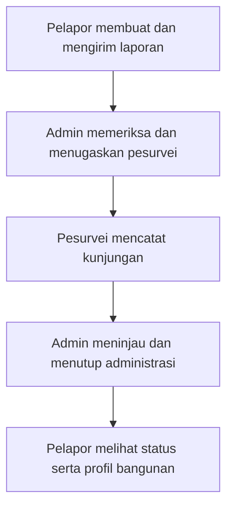

# SeismoPass

SeismoPass adalah prototipe web paspor ketahanan gempa bangunan untuk Bandung Raya, dikembangkan sebagai pendukung esai IYEEA 2026. Aplikasi ini memperagakan pencatatan bangunan, alur laporan pelapor–admin–pesurvei, profil digital, serta simulasi pendidikan RVS (_Rapid Visual Screening_).

Dibangun dengan React, TypeScript, dan Vite. Halaman depan menampilkan informasi gempa dari BMKG serta peta lokasi menggunakan Leaflet dan OpenStreetMap.

> Aplikasi masih berupa frontend dengan data contoh; backend dan autentikasi produksi belum tersedia. Data percobaan disimpan selama sesi tab browser jika tersedia. RVS adalah penyaringan awal, **bukan sertifikat aman**, dan tidak menggantikan evaluasi ahli struktur.

## Clone proyek

Siapkan Git dan Node.js **24.11.0** sesuai [`.nvmrc`](.nvmrc), lalu jalankan:

```bash
git clone https://github.com/rkthooriq/SeismoPass.git
cd SeismoPass
```

## Jalankan aplikasi

```bash
npm ci
npm run dev
```

Buka alamat yang ditampilkan terminal, biasanya **http://localhost:5173**. Jika port sudah digunakan, Vite akan memilih port lain. Hentikan aplikasi dengan **Ctrl+C**.

Tidak perlu membuat file `.env` untuk menjalankan prototipe saat ini. Informasi BMKG dan peta memerlukan koneksi internet. Gunakan data fiktif ketika mencoba.

## Alur mencoba aplikasi

Setelah aplikasi terbuka, pilih **Masuk** atau buka `/#/login` pada alamat lokal. Gunakan akun contoh berikut; semuanya memakai kata sandi **`SeismoDemo123!`**.

| Peran    | Email                  |
| -------- | ---------------------- |
| Pelapor  | `pelapor@example.com`  |
| Admin    | `admin@example.com`    |
| Pesurvei | `pesurvei@example.com` |

Gunakan **satu tab browser yang sama** sepanjang percobaan. Tekan **Keluar**, lalu masuk dengan akun berikutnya untuk berganti peran. Gunakan nama bangunan yang mudah dikenali agar laporan yang sama dapat ditemukan pada setiap tahap.



1. **Pelapor — buat laporan.** Masuk sebagai pelapor, pilih **Buat laporan**, lalu isi seluruh kolom wajib dengan data fiktif. Centang persetujuan dan pemahaman batas RVS, lalu pilih **Simpan dan kirim laporan**. Laporan berstatus **Dikirim** muncul di **Laporan saya**.
2. **Admin — periksa dan tugaskan.** Berganti ke akun admin. Buka **Laporan masuk**, perluas laporan tadi, lalu pilih **Data lengkap, siap ditugaskan**. Buka **Penugasan survei**, pilih **Pesurvei Contoh**, isi catatan penugasan, dan tekan **Simpan penugasan**. Status menjadi **Ditugaskan**.
3. **Pesurvei — catat kunjungan.** Berganti ke akun pesurvei. Buka **Penugasan saya**, perluas laporan, dan tekan **Mulai survei**. Isi tanggal serta catatan kunjungan contoh, lalu pilih **Kirim catatan ke admin**. Status menjadi **Ditinjau**. Input simulasi RVS dapat dicoba saat laporan masih **Dalam survei** melalui **Isi input RVS dan lihat hasil simulasi**.
4. **Admin — tinjau catatan.** Masuk kembali sebagai admin dan buka **Tinjauan catatan**. Isi catatan tinjauan administrasi, lalu pilih **Tutup administrasi laporan**. Status menjadi **Selesai**. Untuk mencoba alur perbaikan, pilih **Minta revisi**, lalu masuk sebagai pesurvei untuk memperbaiki dan mengirim ulang catatan.
5. **Pelapor — lihat hasil proses.** Masuk kembali sebagai pelapor, buka **Laporan saya**, lalu perluas laporan untuk membaca profil bangunan dan riwayat proses. Status **Selesai** berarti administrasi ditutup, bukan bangunan dinyatakan aman; hasil simulasi belum menjadi penilaian resmi.

Laporan contoh pada beberapa tahap juga tersedia jika ingin langsung menjelajahi setiap peran. Setelah refresh, masuk kembali; data laporan bertahan selama sesi tab jika penyimpanan browser tersedia, tanpa sinkronisasi antarperangkat.

## Memeriksa build

Untuk memeriksa build secara lokal:

```bash
npm run build
npm run preview
```
