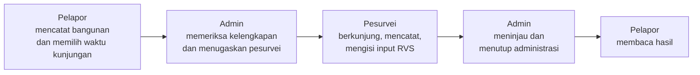

# SeismoPass

Paspor ketahanan gempa untuk bangunan di Bandung Raya.

Banyak rumah dan bangunan kecil di kawasan Sesar Lembang dibangun tanpa pernah dicek ketahanannya terhadap gempa. SeismoPass adalah prototipe web yang memperagakan bagaimana pencatatan bangunan, kunjungan survei, dan penyaringan awal (*Rapid Visual Screening*, RVS) bisa berjalan dalam satu alur yang rapi, dari warga yang melapor sampai petugas yang mengunjungi.

>Semua data fiktif dan tersimpan hanya di browser, belum ada backend. RVS di sini adalah **simulasi pendidikan**, bukan penilaian resmi dan **bukan sertifikat aman**.

## Alur tiga peran

Satu laporan bangunan melewati tiga orang:

- **Pelapor** membuat laporan dalam tiga langkah (data bangunan, lokasi dan akses, periksa dan kirim), menandai titik di peta, melampirkan foto, dan memilih waktu kunjungan yang cocok.
- **Admin** memeriksa kelengkapan data, menugaskan pesurvei, menetapkan jadwal, lalu meninjau hasil survei. Jika waktu pilihan pelapor dipakai, jadwal langsung disepakati. Jika diganti, pelapor mengonfirmasi atau meminta waktu lain.
- **Pesurvei** hanya melihat tugas yang diberikan kepadanya. Survei baru bisa dimulai setelah jadwal disepakati, lalu diisi lewat halaman tiga langkah: kunjungan, input RVS, periksa dan kirim.

Setiap serah-terima tercatat dalam riwayat yang sama dan terlihat oleh ketiga peran.

## Fitur utama

- **Beranda publik** dengan informasi gempa terkini dari BMKG, peta kawasan, riwayat kejadian di Sesar Lembang, dan data dampak gempa.
- **Akun tiga peran**: satu halaman masuk untuk Pelapor, Admin, dan Pesurvei; peran ditentukan oleh akun yang digunakan. Pelapor dapat mendaftar, sedangkan akun pesurvei disiapkan admin.
- **Simulasi RVS** dengan tabel FEMA P-154 Level 1, dilengkapi hasil perhitungan dan QR berisi data minimum.
- **Pelacakan status** dengan warna yang menunjukkan siapa yang sedang memegang laporan.
- **Antarmuka responsif** untuk HP, tablet, dan laptop, dengan paginasi, filter, dan pencarian di setiap daftar.

## Pertimbangan desain

- **Batas domain ditulis jujur.** RVS hanya penyaringan awal. Tidak ada skor, kategori risiko, atau klaim keselamatan bangunan yang dibuat sendiri; penilaian resmi menunggu protokol dan validasi ahli struktur.
- **Privasi.** Alamat, patokan, dan nomor kontak hanya terlihat oleh admin dan pesurvei yang ditugaskan. QR tidak membawa identitas, alamat, atau foto.
- **Akses sesuai peran.** Setiap peran hanya bisa membuka halamannya sendiri. Ini masih pembatasan di sisi tampilan; untuk data nyata, pemeriksaan harus dilakukan di server.
- **Konsistensi tampilan.** Warna, jarak, radius, dan tipografi mengikuti satu sistem token, dengan tema warna tanah yang terang.

## Teknologi

React, TypeScript (mode ketat), Vite, Leaflet dan OpenStreetMap untuk peta, data terbuka BMKG untuk informasi gempa, dan pengujian dengan Node.js test runner serta Playwright untuk alur di browser. Dipublikasikan melalui Vercel.

## Menjalankan pengujian

- `npm test`: tes logika dengan Node.js test runner.
- `npm run test:e2e`: tes alur di browser (pelapor, admin, pesurvei, akses, aksesibilitas, dan lebar layar). Server pengembangan dijalankan otomatis. Pasang browser sekali dengan `npx playwright install chromium`, atau pakai Google Chrome yang sudah terpasang dengan `PW_CHANNEL=chrome npm run test:e2e`.
- Tes ini memakai data fiktif dan akun bawaan; tidak menggantikan uji bersama pengguna.

## Status dan rencana

Prototipe ini sudah mencakup alur lengkap tiga peran di sisi tampilan. Langkah berikutnya adalah backend dengan database, login nyata, dan pemeriksaan akses di server, kemudian pengujian bersama calon pengguna dan penerapan protokol RVS yang divalidasi ahli struktur.
