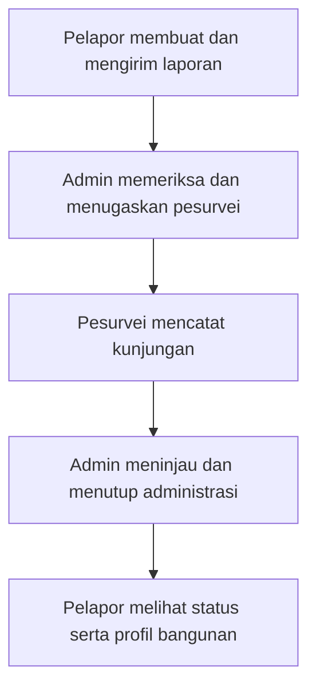

# SeismoPass

SeismoPass adalah prototipe web paspor ketahanan gempa bangunan untuk Bandung Raya, dikembangkan sebagai pendukung esai IYEEA 2026. Aplikasi ini memperagakan pencatatan bangunan, alur laporan pelapor–admin–pesurvei, profil digital, serta simulasi pendidikan RVS (*Rapid Visual Screening*).

Dibangun dengan React, TypeScript, dan Vite. Halaman depan menampilkan informasi gempa dari BMKG serta peta lokasi menggunakan Leaflet dan OpenStreetMap.

> Aplikasi masih berupa frontend dengan data contoh; backend dan autentikasi produksi belum tersedia. Data percobaan disimpan selama sesi tab browser jika tersedia. RVS adalah penyaringan awal, **bukan sertifikat aman**, dan tidak menggantikan evaluasi ahli struktur.

## Persiapan

Sebelum menjalankan SeismoPass, pastikan Git dan Node.js sudah terpasang di komputer:

- **Git** digunakan untuk mengambil proyek dari GitHub dan mendapatkan pembaruan.
- **Node.js** digunakan untuk menjalankan proyek. **npm**, yang digunakan untuk mengunduh kebutuhan proyek, ikut terpasang bersama Node.js.

### 1. Periksa Git dan Node.js

Buka terminal di komputer:

- **Windows:** buka Command Prompt, PowerShell, atau terminal di VS Code.
- **Mac:** buka aplikasi Terminal atau terminal di VS Code.

Jalankan perintah berikut satu per satu:

```bash
git --version
node --version
npm --version
```

Jika ketiganya menampilkan nomor versi, kamu dapat melanjutkan ke bagian **Clone proyek**. Proyek ini merekomendasikan Node.js **24.11.0** sesuai file [`.nvmrc`](.nvmrc). Jika Git atau Node.js belum terpasang, ikuti langkah di bawah.

### 2. Instal Git

#### Windows

1. Buka [halaman Git untuk Windows](https://git-scm.com/install/windows).
2. Unduh **Git for Windows/x64 Setup**. Jika komputer menggunakan prosesor ARM, pilih versi **ARM64**.
3. Buka file yang sudah diunduh dan ikuti proses instalasi. Pengaturan bawaan dapat digunakan.
4. Setelah selesai, tutup dan buka kembali terminal.
5. Periksa instalasi:

```bash
git --version
```

Jika muncul nomor versi, Git sudah terpasang.

#### Mac

1. Buka aplikasi **Terminal**.
2. Jalankan perintah berikut:

```bash
xcode-select --install
```

3. Jika muncul jendela instalasi, pilih **Install** dan ikuti petunjuk hingga selesai.
4. Periksa instalasi:

```bash
git --version
```

Jika Mac menyatakan bahwa *command line tools* sudah terpasang, langsung jalankan perintah pemeriksaan di atas.

### 3. Instal Node.js

Jika Node.js belum terpasang, ikuti langkah berikut:

1. Buka [halaman unduhan Node.js 24.11.0](https://nodejs.org/en/download/archive/v24.11.0).
2. Pada bagian **Installer Packages**, pilih file sesuai komputer:
   - **Windows x64:** `node-v24.11.0-x64.msi`.
   - **Windows ARM64:** `node-v24.11.0-arm64.msi`.
   - **Mac:** `node-v24.11.0.pkg`.
3. Buka file yang diunduh dan ikuti petunjuk instalasi hingga selesai.
4. Tutup dan buka kembali terminal.
5. Periksa Node.js dan npm:

```bash
node --version
npm --version
```

Perintah pertama akan menampilkan `v24.11.0` jika versi tersebut terpasang. Perintah kedua akan menampilkan versi npm.

> Jika Node.js sudah terpasang untuk proyek lain, periksa versinya sebelum mengganti instalasi. Pertimbangkan menggunakan pengelola versi Node.js jika membutuhkan versi yang berbeda untuk setiap proyek.

## Clone proyek

Buka terminal di lokasi tempat proyek ingin disimpan, lalu jalankan:

```bash
git clone https://github.com/rkthooriq/SeismoPass.git
cd SeismoPass
```

## Jalankan aplikasi

Pastikan terminal berada di folder `SeismoPass`, lalu jalankan:

```bash
npm ci
npm run dev
```

Buka alamat yang ditampilkan terminal, biasanya **http://localhost:5173**. Jika port sudah digunakan, Vite akan memilih port lain. Hentikan aplikasi dengan **Ctrl+C**.

Tidak perlu membuat file `.env` untuk menjalankan prototipe saat ini. Informasi BMKG dan peta memerlukan koneksi internet. Gunakan data fiktif ketika mencoba.

### Jika perintah belum dikenali

Jika muncul pesan seperti `command not found` atau `is not recognized`:

1. Pastikan Git atau Node.js sudah selesai diinstal.
2. Tutup terminal, lalu buka kembali.
3. Jalankan kembali perintah pemeriksaan versi.
4. Jika memakai terminal di VS Code dan perintah masih belum dikenali, tutup dan buka kembali VS Code.

## Mengambil update terbaru

Tidak perlu clone ulang. Hentikan aplikasi dengan **Ctrl+C**, buka terminal di folder SeismoPass pada branch `main`, lalu jalankan:

```bash
git pull --ff-only origin main
npm ci
npm run dev
```

Buka kembali alamat yang muncul di terminal. `--ff-only` mencegah penggabungan riwayat secara otomatis. Jika punya perubahan sendiri, simpan atau commit terlebih dahulu. Jika Git menolak update karena riwayat berbeda, hentikan dan periksa penyebabnya; jangan memaksa atau menghapus pekerjaan lokal.

## Alur mencoba aplikasi

Setelah aplikasi terbuka, pilih **Masuk** atau buka `/#/login` pada alamat lokal. Gunakan akun contoh berikut; semuanya memakai kata sandi **`SeismoDemo123!`**.

| Peran | Email |
| --- | --- |
| Pelapor | `pelapor@example.com` |
| Admin | `admin@example.com` |
| Pesurvei | `pesurvei@example.com` |

Gunakan **satu tab browser yang sama** sepanjang percobaan. Tekan **Keluar**, lalu masuk dengan akun berikutnya untuk berganti peran. Gunakan nama bangunan yang mudah dikenali agar laporan yang sama dapat ditemukan pada setiap tahap.



1. **Pelapor — buat laporan.** Masuk sebagai pelapor, pilih **Buat laporan**, lalu ikuti tiga langkah: **Data bangunan**, **Lokasi & akses**, dan **Periksa & kirim**. Gunakan data fiktif; titik peta dan foto bersifat opsional. Centang persetujuan dan pemahaman batas RVS, lalu pilih **Simpan dan kirim laporan**. Laporan berstatus **Dikirim** muncul di **Laporan saya**.
2. **Admin — periksa dan tugaskan.** Berganti ke akun admin. Buka **Laporan masuk**, perluas laporan tadi, lalu pilih **Data lengkap, siap ditugaskan**. Buka **Penugasan survei**, pilih **Pesurvei Contoh**, isi catatan penugasan, dan tekan **Simpan penugasan**. Status menjadi **Ditugaskan**.
3. **Pesurvei — catat kunjungan.** Berganti ke akun pesurvei. Buka **Penugasan saya**, perluas laporan, dan tekan **Mulai survei**. Isi tanggal serta catatan kunjungan contoh, lalu pilih **Kirim catatan ke admin**. Status menjadi **Ditinjau**. Input simulasi RVS dapat dicoba saat laporan masih **Dalam survei** melalui **Isi input RVS dan lihat hasil simulasi**.
4. **Admin — tinjau catatan.** Masuk kembali sebagai admin dan buka **Tinjauan catatan**. Isi catatan tinjauan administrasi, lalu pilih **Tutup administrasi laporan**. Status menjadi **Selesai**. Untuk mencoba alur perbaikan, pilih **Minta revisi**, lalu masuk sebagai pesurvei untuk memperbaiki dan mengirim ulang catatan.
5. **Pelapor — lihat hasil proses.** Masuk kembali sebagai pelapor, buka **Laporan saya**, lalu pilih **Lihat perjalanan bangunan**. Tab **Perjalanan** memuat profil dan riwayat; **Lokasi & foto** untuk dokumentasi; **Jadwal survei** untuk koordinasi waktu; **Tindak lanjut** dan **Dukungan** untuk mencatat kebutuhan. Status **Selesai** berarti administrasi ditutup, bukan bangunan dinyatakan aman; hasil simulasi belum menjadi penilaian resmi.

Laporan contoh pada beberapa tahap juga tersedia jika ingin langsung menjelajahi setiap peran. Setelah refresh, masuk kembali; data laporan bertahan selama sesi tab jika penyimpanan browser tersedia, tanpa sinkronisasi antarperangkat.

Untuk mencoba jadwal, pelapor mencatat waktu tersedia di **Jadwal survei**. Admin dapat mengusulkan tanggal dan rentang waktu pada formulir penugasan. Setelah ada usulan, pelapor dapat memilih **Jadwal ini cocok** atau **Minta jadwal lain**. Waktu tersedia tidak otomatis menjadi jadwal yang disepakati.

Foto disimpan terpisah di penyimpanan browser lokal, maksimal empat foto JPG/PNG/WebP berukuran 2 MB per foto; foto tidak diunggah ke server atau dimasukkan ke QR. Menghapus data situs akan menghapus foto. Kebutuhan dukungan hanya dicatat sebagai minat, karena belum ada program aktif; catatan pekerjaan pemilik belum menjadi verifikasi ahli.

## Memeriksa build

Untuk memeriksa build secara lokal:

```bash
npm run build
npm run preview
```
