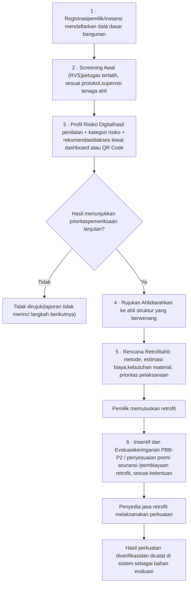

Peta belajar · Esai IYEEA 2026 · Tim 404 Not Found

# SeismoPass: alur produk sesuai laporan

Halaman ini hanya memuat apa yang tertulis di laporan: 6 tahap alur kerja, siapa yang terlibat, dan aturan yang harus dipenuhi platform. Hal yang belum dijelaskan laporan ditandai di bagian 07.

**Platform:** produk berupa web (keputusan tim; laporan sendiri hanya menyebut "platform SeismoPass", "dashboard", dan "QR Code"). Bagian "Mock Up SeismoPass" di halaman 7 laporan masih kosong, jadi tampilan layar belum ada di laporan.

## 01Intinya apa sih?

Bandung Raya berada di dekat **Sesar Lembang**, yang bisa memicu gempa sampai magnitudo 6,8. Besar risiko tidak hanya ditentukan kuatnya guncangan, tetapi juga **kerentanan bangunan**. Gempa Cianjur 2022 (M5,6) merusak 56.311 rumah. Pemilik bangunan belum tentu punya informasi yang mudah dipahami tentang ketahanan gempa bangunannya, dan perkuatan (retrofit) butuh biaya.

SeismoPass adalah **sistem paspor ketahanan gempa bangunan berbasis Rapid Visual Screening (RVS)** yang menggabungkan profil risiko digital, rujukan pemeriksaan teknis, dan insentif ekonomi. Laporan menegaskan kebaruannya ada pada **keterhubungan alur**, bukan pada label atau kode QR.

Analogi · RVSSeperti cek kesehatan awal. Cepat dan standar, tapi bukan diagnosis akhir.

Analogi · Profil risikoSeperti kartu hasil cek. Isinya hasil dan saran, bukan surat "dinyatakan aman".

Analogi · Rujukan ahliSeperti dirujuk ke dokter spesialis kalau hasil awal menunjukkan perlu pemeriksaan lanjut.

Analogi · InsentifSeperti bantuan biaya supaya pemilik mau memperkuat bangunannya.

## 02Istilah yang wajib paham

| Istilah | Arti menurut laporan |
| --- | --- |
| **RVS** | Rapid Visual Screening, penyaringan awal kerentanan bangunan (pedoman FEMA P-154). Hanya penyaringan awal, jadi tetap perlu evaluasi lanjutan oleh tenaga ahli. |
| **Retrofit** | Perkuatan struktur bangunan yang sudah ada. |
| **Asimetri informasi** | Ketidakseimbangan informasi antarpihak (Akerlof, 1970). Di sini: pemilik sulit memahami kondisi ketahanan bangunannya. |
| **PBB-P2** | Pajak Bumi dan Bangunan Perdesaan dan Perkotaan. Keringanannya adalah salah satu insentif yang diusulkan. |
| **Insentif fiskal vs nonfiskal** | Fiskal bergantung pada keputusan daerah (kewenangan lewat perkada), jadi tidak boleh diasumsikan berlaku. Nonfiskal (konsultasi teknis, prioritas pendampingan retrofit, kemitraan pembiayaan dan asuransi) menjadi fondasi pilot. |
| **Pilot** | Uji coba 6 bulan di Desa Jambudipa, Kecamatan Cisarua, Kabupaten Bandung Barat, dengan target 250 bangunan prioritas. |

## 03Siapa saja yang terlibat

Dari Tabel 1 laporan, ditambah petugas penilai (tahap 2) dan mitra sektor keuangan (tahap 6) yang disebut di bagian Desain SeismoPass.

| Aktor | Peran di SeismoPass | Kebutuhan koordinasi |
| --- | --- | --- |
| **Pemilik dan pengelola bangunan** | Memberi persetujuan dan akses; memutuskan retrofit | Edukasi bahwa hasil bukan sertifikat aman |
| **Petugas penilai** (terlatih) | Melakukan screening awal RVS sesuai protokol | Disupervisi tenaga ahli |
| **Ahli struktur dan perguruan tinggi** | Memvalidasi metode dan ambang; menyupervisi petugas; menerima rujukan | Kerja sama tertulis; verifikasi sampel |
| **Pemerintah daerah** (Bapenda, BPBD, dinas teknis) | Menetapkan perkada insentif; mendukung izin data; menindaklanjuti peta risiko | Kajian hukum; pemberitahuan kepada DPRD |
| **Penyedia jasa retrofit** | Melaksanakan perkuatan sesuai rencana ahli | Transparansi vendor; terpisah dari penilai |
| **Mitra sektor keuangan** | Pembiayaan dan penyesuaian premi asuransi, jika disepakati | Kerja sama yang tersedia |

## 04Alur kerja: 6 tahap (Gambar 7)

Kotak bernomor adalah enam tahap dari laporan. Satu-satunya percabangan adalah di tahap 4: hanya bangunan yang hasil screening-nya menunjukkan prioritas pemeriksaan lanjutan yang dirujuk ke ahli.

## 05Isi tiap tahap menurut laporan

| Tahap | Siapa | Yang dilakukan | Hasil di platform |
| --- | --- | --- | --- |
| **1 Registrasi** | Pemilik atau instansi | Mengisi data dasar: lokasi, fungsi, tahun pembangunan, jumlah lantai, material, sistem struktur | Data bangunan terdaftar |
| **2 Screening Awal (RVS)** | Petugas terlatih + supervisi ahli | Penilaian awal dengan metode RVS sesuai protokol dan standar yang berlaku | Hasil screening |
| **3 Profil Risiko** | Sistem; pemilik mengakses | Hasil screening diolah menjadi profil digital | Hasil penilaian, kategori risiko, rekomendasi tindak lanjut; dibuka lewat dashboard atau QR Code |
| **4 Rujukan Ahli** | Ahli struktur | Evaluasi teknis yang lebih mendalam untuk bangunan prioritas | Hasil evaluasi ahli |
| **5 Rencana Retrofit** | Ahli struktur | Menyusun rekomendasi perkuatan | Metode retrofit, estimasi biaya, kebutuhan material, prioritas pelaksanaan |
| **6 Insentif dan Evaluasi** | Pemilik; pemda; mitra keuangan | Mengakses dukungan, lalu perkuatan diverifikasi | Dukungan dicatat; hasil perkuatan tercatat sebagai bahan evaluasi |

## 06Aturan dari laporan yang harus dipenuhi platform

Diambil dari Tabel 4 (risiko dan mitigasi) dan Tabel 1.

| Risiko | Mitigasi menurut laporan |
| --- | --- |
| Label atau QR Code disangka sertifikat bangunan aman | Disclaimer pada profil digital, edukasi pemilik, jalur rujukan pemeriksaan ahli |
| Hasil screening tidak konsisten antarpetugas | Pelatihan dan protokol terstandar, supervisi ahli, audit sampel hasil |
| Data disalahgunakan atau diakses pihak tidak berwenang | Minimisasi data, persetujuan pemilik, pembatasan hak akses, perlindungan informasi pribadi |
| Konflik kepentingan penilai dan penyedia retrofit | Fungsi penilaian dan pelaksanaan dipisah, vendor transparan, tidak ada kewajiban memakai penyedia tertentu |
| Insentif fiskal tidak tersedia atau tidak mencakup rumah tinggal | Mulai dari bangunan usaha, kajian hukum bersama Bapenda, insentif nonfiskal berjalan sejak pilot |

## 07Yang belum dijelaskan laporan

Bagian ini sengaja dipisah supaya tidak tercampur dengan isi laporan. Semua ini perlu keputusan tim kalau mau dituliskan atau digambar.

| Hal | Keadaan di laporan |
| --- | --- |
| Nama dan jumlah kategori risiko | Hanya disebut "kategori risiko"; ambang divalidasi ahli struktur pada fase protokol |
| Isi formulir RVS | Merujuk ke formulir FEMA P-154 (Gambar 5); tidak dirinci |
| Tampilan layar | Bagian "Mock Up SeismoPass" (hal. 7) kosong |
| Akun dan akses tiap aktor di platform | Hanya disebut pemilik mengakses lewat dashboard atau QR Code |
| Langkah untuk bangunan yang tidak dirujuk | Tidak dijelaskan |
| Web / mobile, mode offline | Tidak disebut. Web adalah keputusan tim |

Sumber: esai "SeismoPass" (IYEEA 2026), terutama Gambar 7, Tabel 1 dan 4, serta bagian Desain SeismoPass dan Pilot.

## 08Catatan keputusan pengembangan

Catatan ini merupakan penanda perencanaan, bukan tambahan isi laporan. Lihat [rencana pengembangan](plan.md).

- **DIPUTUSKAN PENGGUNA:** frontend web menggunakan React, TypeScript, dan Vite.
- **BATAS TAHAP SAAT INI:** hanya penjelasan dan dokumentasi; belum menulis kode aplikasi, push ke GitHub, atau publikasi.
- **BELUM DIPUTUSKAN — DOMAIN:** rincian formulir/protokol RVS, rumus/skor, kategori dan ambang rujukan harus ditetapkan serta divalidasi ahli. Tidak boleh dibuat sendiri oleh pengembang.
- **BELUM DIPUTUSKAN — PRODUK:** rancangan layar, pembagian akun/hak akses, informasi QR publik, tindak lanjut bangunan yang tidak dirujuk, serta kebutuhan offline.
- **BELUM DIPUTUSKAN — TEKNIS DAN OPERASIONAL:** backend, database, autentikasi, hosting/domain, tata kelola data, dan penanggung jawab operasional. Aktor pada laporan tidak otomatis berarti akun aplikasi.
- **BERGANTUNG PERSETUJUAN PIHAK TERKAIT:** ketersediaan insentif fiskal dan dukungan mitra; bukan manfaat yang otomatis berlaku.

RVS tetap penyaringan awal, bukan sertifikat aman. Rencana sampai publikasi tidak merupakan persetujuan untuk menjalankan semua tahap sekarang.
