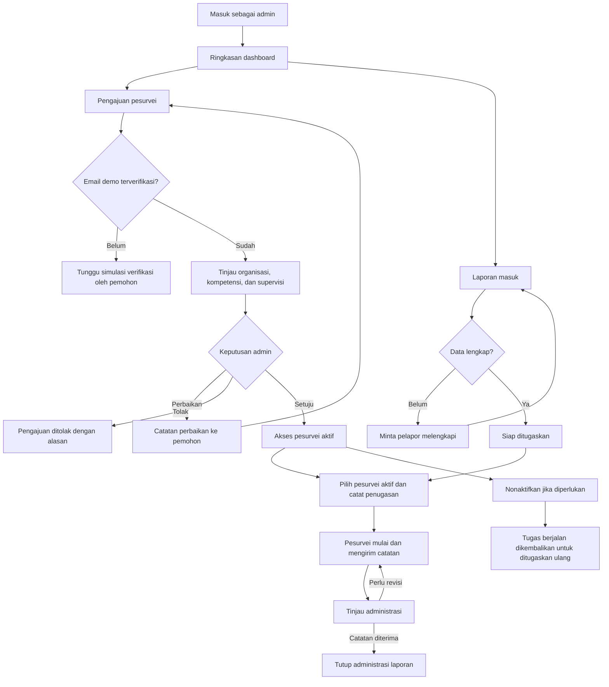
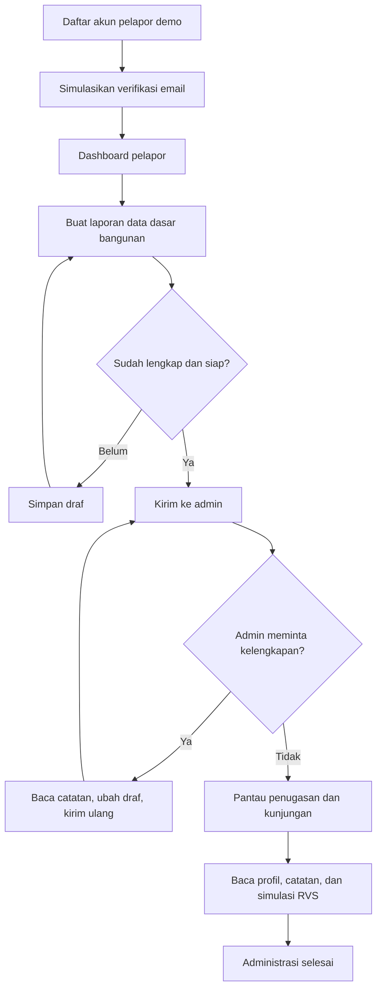
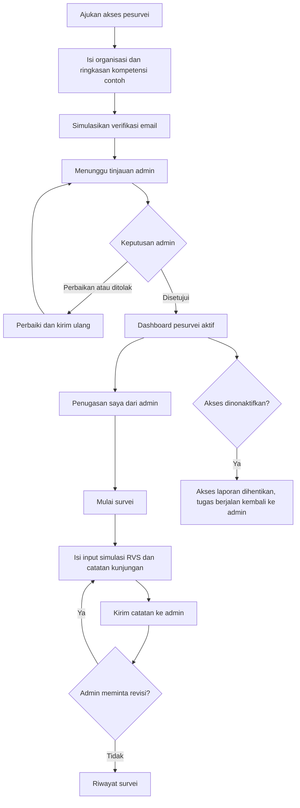

# Alur admin, pelapor, dan pesurvei

Alur ini mengikuti keputusan pengguna: admin menyetujui akses pesurvei dan menentukan penugasan. Demo memakai data fiktif di sesi tab yang sama. Buka `#/flows` untuk panduan visual tiga peran, atau menu **Panduan alur** dari sidebar.

## Admin

Menu: Ringkasan, Pengajuan pesurvei, Kelola pesurvei, Laporan masuk, Penugasan survei, Tinjauan catatan, Semua laporan, Rencana pilot, Panduan alur. Penolakan, permintaan perbaikan, persetujuan, penonaktifan, dan pengaktifan kembali membutuhkan catatan. Persetujuan/pengaktifan kembali juga membutuhkan konfirmasi pemeriksaan kompetensi.

Admin memeriksa administrasi; penerimaan catatan bukan validasi teknis RVS. Tugas yang telah dikirim untuk ditinjau atau ditutup tetap menjadi riwayat saat akses pesurvei dinonaktifkan.

## Pelapor

Menu: Laporan saya, Buat laporan, Panduan alur. Tidak ada halaman Ringkasan karena pelapor hanya mencatat lalu menunggu; halaman awalnya Laporan saya, yang memuat kartu **Langkah berikutnya** (giliranmu atau menunggu) per laporan. Pelapor hanya melihat laporannya sendiri dan hanya dapat mengubah draf atau laporan yang dikembalikan untuk dilengkapi. Profil/QR tetap memuat batas RVS.

## Pesurvei

Menu: Ringkasan, Penugasan saya, Riwayat survei, Panduan alur. Pesurvei tidak mengambil laporan dari antrean umum. Akses baru tersedia setelah persetujuan, dan setiap laporan harus ditugaskan admin. Input/kunjungan dapat diubah saat **Dalam survei** atau **Perlu revisi**, lalu terkunci di tampilan setelah dikirim untuk tinjauan.

## Urutan mencoba dengan akun contoh

Semua akun demo memakai kata sandi bersama `SeismoDemo123!`. Kata sandi pengguna tidak disimpan pada sessionStorage.

1. Masuk sebagai `admin@example.com`, buka **Pengajuan pesurvei**, lalu tinjau `calon@example.com`. Contoh calon ini sudah memiliki simulasi verifikasi email agar peninjauan bisa dicoba langsung.
2. Untuk mencoba dari awal, buka halaman **Calon pesurvei? Ajukan akses**, gunakan email baru berakhiran `@example.com`, lalu simulasikan verifikasi. Keluar dan masuk admin untuk meninjau.
3. Masuk `pelapor@example.com`, buat dan kirim laporan. Admin memeriksa pada **Laporan masuk**.
4. Admin membuka **Penugasan survei**, memilih pesurvei aktif, dan mengisi catatan penugasan.
5. Keluar lalu masuk memakai email pesurvei yang dipilih. Buka **Penugasan saya**, mulai, isi simulasi RVS jika diperlukan, dan kirim catatan kunjungan.
6. Admin meninjau, meminta revisi atau menutup administrasi. Pelapor mengikuti status melalui **Laporan saya**.
7. Untuk mencoba pencabutan akses, admin membuka **Kelola pesurvei** dan menonaktifkan akun dengan alasan. Tugas berjalan kembali ke penugasan; akun tersebut tidak lagi dapat membuka laporan.

Akun, keputusan, dan laporan bertahan setelah refresh selama sessionStorage tersedia. Sesi aktif login tidak dipulihkan; masuk lagi setelah refresh. Menutup tab mengakhiri sesi (browser dapat memulihkan sesi ketika memulihkan tab). Data tidak tersinkron antar-tab/perangkat.

## Batas demo dan kebutuhan produksi

Verifikasi email adalah simulasi dengan tombol, bukan bukti kepemilikan email. Kredensial bersama dan pembatasan frontend ini bukan autentikasi atau otorisasi produksi. Layanan nyata perlu akun unik, verifikasi email server, pemeriksaan peran/status/penugasan per permintaan, pencabutan sesi, MFA admin, audit yang terlindungi, dan tata cara verifikasi kompetensi yang disepakati. Penyedia backend/identitas serta kebijakan operasional masih belum dipilih.

Persetujuan admin tidak menggantikan pelatihan dan supervisi ahli. RVS adalah penyaringan awal, bukan sertifikat aman. Penutupan laporan tidak mengesahkan skor simulasi, retrofit, atau insentif.
